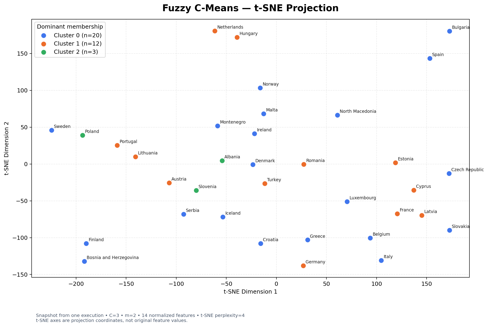

# Fuzzy C-Means Clustering Desktop App

Aplikasi desktop berbasis **Python** dan **PyQt6** untuk memuat dataset, melihat pratinjau data, menjalankan clustering menggunakan **Fuzzy C-Means (FCM)**, serta meninjau derajat keanggotaan dan visualisasi hasil.

> **Konteks proyek:** proyek ini dikembangkan secara kolaboratif. Salinan ini dirapikan untuk kebutuhan dokumentasi/portofolio pribadi; kontribusi tim dan repository asal tetap perlu dicantumkan. Repository kelompok: [AddienZakia/tubes-plm](https://github.com/AddienZakia/tubes-plm).

## Fitur utama

- Memuat file CSV dan menampilkan pratinjau data.
- Menjalankan Fuzzy C-Means dengan konfigurasi aplikasi `C=3` dan `m=2`.
- Menampilkan tabel derajat keanggotaan setiap negara pada masing-masing cluster dan label cluster dominan.
- Menampilkan proyeksi dua dimensi t-SNE serta riwayat objective function.
- Menyediakan komponen antarmuka PyQt6 yang reusable di `src/components/`.

## Metode

Implementasi model berada di [`src/utils/model.py`](src/utils/model.py). Secara ringkas, pipeline yang tertulis di kode adalah:

1. Membaca data CSV dengan pemisah titik koma (`;`).
2. Mengambil 14 fitur numerik per negara (gabungan indikator tahun 2018 dan 2021, termasuk kelompok All Individuals, Gen Y, Gen X, serta indikator berdasarkan gender).
3. Melakukan normalisasi min–max per fitur.
4. Menginisialisasi matriks membership secara acak, menghitung centroid berbobot, lalu memperbarui membership berdasarkan jarak Euclidean.
5. Menghitung objective function dan menghentikan iterasi ketika perubahan membership (`ΔU`) lebih kecil dari `epsilon`, atau ketika batas iterasi tercapai.
6. Menentukan label tampilan dengan mengambil cluster yang memiliki nilai membership terbesar untuk setiap negara. Nilai membership lengkap tetap tersedia pada tabel hasil.

Konfigurasi yang dipakai halaman aplikasi saat tombol clustering dijalankan adalah `C=3`, `m=2`, `max_iter=100`, dan `epsilon=1e-4` (nilai batas iterasi dan toleransi mengikuti default `fit`).

### Catatan reproduksibilitas dan interpretasi

- Inisialisasi membership pada implementasi saat ini menggunakan bilangan acak dan tidak menetapkan random seed. Karena itu, hasil membership, label dominan, jumlah anggota per cluster, dan jumlah iterasi dapat berbeda antar-eksekusi. Angka pada gambar di bawah adalah **snapshot dari satu eksekusi**, bukan klaim hasil yang selalu identik.
- Fungsi pembaca data di `src/utils/file.py` mengubah nilai numerik CSV menjadi `int` sebelum diproses model. Dengan demikian, angka desimal pada CSV dipotong oleh implementasi yang ada. Perilaku ini sengaja tidak diubah dalam perapian portofolio ini agar metode/pipeline kelompok tidak dimodifikasi diam-diam.
- t-SNE hanya digunakan untuk memproyeksikan data berdimensi 14 ke dua dimensi untuk visualisasi. Sumbu t-SNE bukan fitur asli, dan jarak pada plot tidak boleh ditafsirkan sebagai ukuran langsung kualitas cluster.

## Dataset

Dataset utama berada di [`src/contents/dataset.csv`](src/contents/dataset.csv).

- Format: CSV dengan delimiter `;`.
- Unit observasi: negara.
- Jumlah observasi pada berkas yang disertakan: **35 negara**.
- Fitur numerik: **14 kolom** (indikator 2018 dan 2021).
- Berkas dataset dipertahankan tanpa perubahan pada proses perapian ini.

Gunakan dataset ini sesuai ketentuan sumber dan lisensi dari pemilik/pemberi dataset. ZIP yang diberikan tidak menyertakan keterangan sumber atau lisensi dataset secara eksplisit.

## Struktur proyek

```text
.
├── assets/
│   ├── fonts/                 # Font antarmuka
│   └── image/                 # Aset gambar antarmuka
├── docs/
│   ├── components-guide.md    # Panduan komponen PyQt6
│   └── git-guide.md           # Panduan workflow Git
├── outputs/
│   └── fcm_tsne_snapshot.png  # Visualisasi dari satu eksekusi model
├── src/
│   ├── components/            # Komponen UI reusable
│   ├── contents/              # Dataset dan state JSON aplikasi
│   ├── pages/                 # Halaman aplikasi dan navigasi
│   ├── sandbox/               # Area uji komponen
│   ├── utils/                 # Model FCM, pembacaan file, dan utilitas
│   └── main.py                # Entry point aplikasi
├── .gitignore
└── requirements.txt
```

## Instalasi

Disarankan menggunakan Python 3.10 atau lebih baru.

### 1. Clone atau ekstrak proyek

```bash
git clone https://github.com/aisyaasfr/fuzzy-clustering.git
cd fuzzy-clustering
```

Jika menggunakan ZIP, ekstrak terlebih dahulu lalu buka terminal pada folder yang berisi `requirements.txt`.

### 2. Buat dan aktifkan virtual environment

**Windows (PowerShell):**

```powershell
py -m venv .venv
.venv\Scripts\Activate.ps1
```

**Windows (Command Prompt):**

```bat
py -m venv .venv
.venv\Scripts\activate.bat
```

**macOS/Linux:**

```bash
python3 -m venv .venv
source .venv/bin/activate
```

### 3. Pasang dependensi

```bash
python -m pip install --upgrade pip
python -m pip install -r requirements.txt
```

## Menjalankan aplikasi

Dari direktori utama proyek (folder yang berisi `requirements.txt`):

```bash
python -m src.main
```

Aplikasi akan membuka antarmuka desktop. Pilih/unggah file CSV melalui alur aplikasi, tinjau data, lalu jalankan clustering untuk melihat hasil.

Untuk menjalankan sandbox komponen:

```bash
python -m src.sandbox.main
```

## Visualisasi hasil

Gambar berikut merupakan proyeksi t-SNE dari data yang diproses oleh implementasi FCM yang disertakan. Setiap titik mewakili satu negara dan warna menunjukkan label cluster dominan pada eksekusi snapshot tersebut.



Untuk membuat ulang visualisasi melalui aplikasi, jalankan program dan proses dataset. Karena inisialisasi membership acak, hasil snapshot baru dapat berbeda.

## Dokumentasi tambahan

- [Panduan komponen antarmuka](docs/components-guide.md)
- [Panduan Git](docs/git-guide.md)

## Batasan salinan portofolio

Perapian ini berfokus pada dokumentasi, struktur dokumentasi, entry point, state lokal, dan satu visualisasi. Algoritma FCM, parameter default model, dataset, serta alur perhitungan tidak diubah. ZIP asal tidak menyertakan notebook Jupyter, sehingga tidak ada notebook yang perlu dirapikan.
